# Architecture

```mermaid
flowchart LR
  I[IoT / CSV / REST sensor stream] --> M[1. Smart Bin Monitoring]
  M --> F[2. Forecasting]
  F --> P[3. Priority]
  P --> V[4. Vehicle Coordination]
  V --> R[5. Route Optimization]
  R --> C[7. Reviewer / Critic]
  C --> H[Human operator approval]
  H --> T[Collection tracking]
  T --> S[6. Recycling & Segregation]
  S --> D[Dashboard / PDF report]
```

Each agent appends an `AgentEvent` record containing input, output, explanation, stage, status, timestamp, and workflow id. The orchestration layer returns this trace to the dashboard and stores it through the shared repository.

The repository uses SQLAlchemy Core with the existing payload-oriented tables. SQLite is the local development fallback; production requires an explicit PostgreSQL `DATABASE_URL` using psycopg. Alembic migrations are versioned under `backend/migrations` and are run explicitly before deploying a schema change. Production startup checks connectivity and the migration revision but never creates or seeds schema/data.

Operational API endpoints use short-lived HS256 bearer tokens. Passwords are salted and hashed with scrypt. The first administrator is created interactively with `python -m app.create_admin`; there is no default account or public user-registration endpoint. `/health` reports process status and `/ready` checks database readiness.
